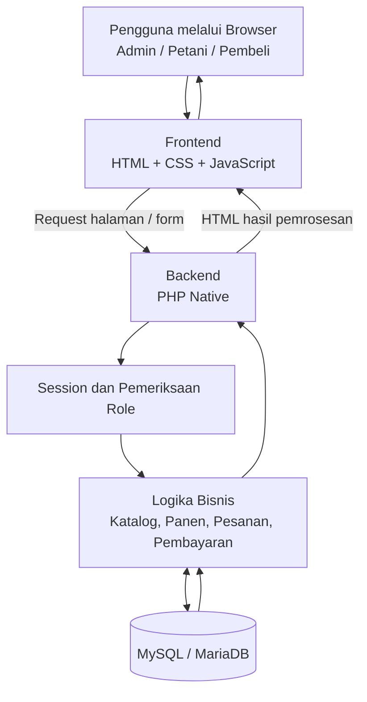
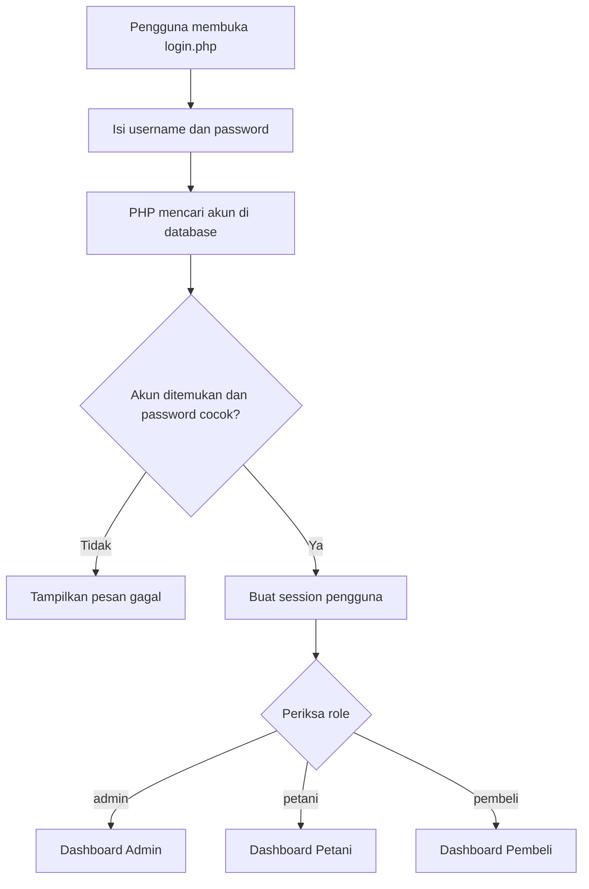
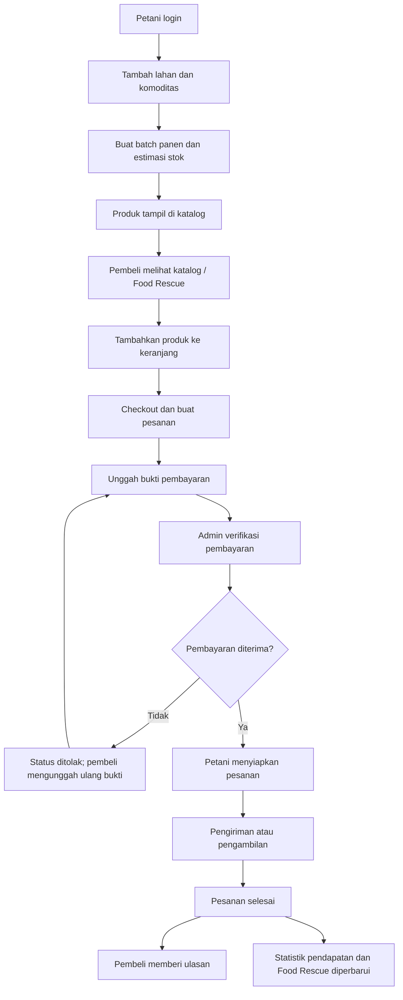
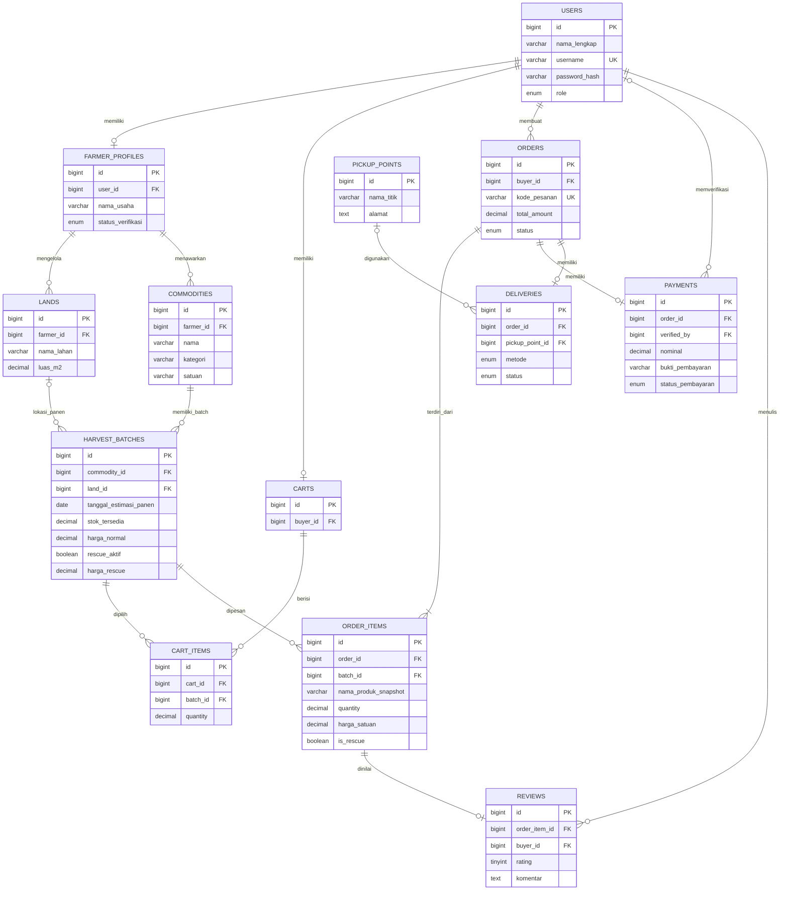

# Rancangan Sistem PanenLokal

> **Platform Pre-Order Hasil Tani dan Penyelamatan Pangan (Food Loss Rescue)**  
> Tema: **SDG 2 — Zero Hunger**  
> Konteks: Proyek akhir Responsi 2 Praktikum Pemrograman Web I  
> Teknologi utama: HTML, CSS, JavaScript, PHP Native, MySQL/MariaDB, dan XAMPP

---

## Daftar Isi

1. [Ringkasan Proyek](#1-ringkasan-proyek)
2. [Latar Belakang, Tujuan, dan Manfaat](#2-latar-belakang-tujuan-dan-manfaat)
3. [Kesesuaian dengan Panduan Responsi](#3-kesesuaian-dengan-panduan-responsi)
4. [Arsitektur Teknis Aplikasi](#4-arsitektur-teknis-aplikasi)
5. [Role dan Hak Akses Pengguna](#5-role-dan-hak-akses-pengguna)
6. [Rancangan Modul Fungsional](#6-rancangan-modul-fungsional)
7. [Struktur Halaman dan Navigasi](#7-struktur-halaman-dan-navigasi)
8. [Alur Bisnis Utama](#8-alur-bisnis-utama)
9. [Rancangan ERD](#9-rancangan-erd)
10. [Kamus Data dan Struktur Tabel](#10-kamus-data-dan-struktur-tabel)
11. [Aturan Bisnis dan Validasi Data](#11-aturan-bisnis-dan-validasi-data)
12. [Struktur Folder Proyek](#12-struktur-folder-proyek)
13. [Pemetaan Materi Praktikum](#13-pemetaan-materi-praktikum)
14. [Pembagian Tugas Tim](#14-pembagian-tugas-tim)
15. [Tahapan Implementasi](#15-tahapan-implementasi)
16. [Batasan dan Asumsi Versi Awal](#16-batasan-dan-asumsi-versi-awal)
17. [SQL Pembuatan Database](#17-sql-pembuatan-database)
18. [Checklist Pengujian Fitur](#18-checklist-pengujian-fitur)

---

## 1. Ringkasan Proyek

**PanenLokal** adalah platform yang menghubungkan petani lokal atau pegiat urban farming dengan konsumen dan warung makan. Platform ini menyediakan katalog hasil tani, pemesanan sebelum masa panen (*pre-order*), serta penawaran khusus untuk hasil panen berlebih atau produk yang mendekati batas kesegaran maksimal (*Food Rescue*).

Masalah utama yang ingin diangkat adalah hasil panen yang tidak terserap pasar sehingga berpotensi terbuang, sementara konsumen membutuhkan akses yang lebih mudah terhadap hasil tani lokal. Dengan menghubungkan petani dan pembeli secara langsung, PanenLokal bertujuan memberi petani kepastian calon pembeli sekaligus membantu mengurangi pangan yang terbuang.

### Sasaran utama

- Membantu petani memasarkan komoditas secara langsung kepada konsumen.
- Memberikan fasilitas pre-order agar petani dapat mengetahui permintaan sebelum panen.
- Menyediakan kanal Food Rescue untuk menjual hasil panen berlebih atau yang perlu segera diserap pasar.
- Memudahkan pembeli memilih produk, membuat pesanan, membayar, dan menerima hasil tani.
- Menampilkan ringkasan transaksi dan jumlah pangan rescue yang berhasil terjual.

### Identitas singkat

| Elemen | Rancangan |
|---|---|
| Nama aplikasi | PanenLokal |
| Jenis aplikasi | Marketplace hasil tani lokal dan Food Rescue |
| Tema SDGs | SDG 2 — Zero Hunger |
| Pengguna | Admin, Petani/Produsen, Pembeli |
| Model aplikasi | Website dinamis berbasis PHP dan database relasional |
| Target implementasi | Aplikasi praktikum yang memiliki alur bisnis utuh dan dapat didemonstrasikan |

---

## 2. Latar Belakang, Tujuan, dan Manfaat

### 2.1 Latar belakang permasalahan

Petani lokal dapat mengalami kesulitan menjangkau pembeli dan memperkirakan jumlah hasil panen yang akan terserap pasar. Di sisi lain, hasil panen berlebih atau produk yang tidak segera terjual berisiko mengalami penurunan kualitas dan terbuang. PanenLokal dirancang sebagai sarana distribusi hilir yang mempertemukan petani dan konsumen melalui katalog dan sistem pemesanan.

### 2.2 Tujuan

1. Menyediakan tempat bagi petani untuk mencatat lahan, komoditas, dan estimasi panen.
2. Menyediakan katalog komoditas hasil tani lokal.
3. Memungkinkan pembeli memesan hasil panen sebelum tanggal panen.
4. Menyediakan fitur Food Rescue untuk produk yang perlu segera dipasarkan.
5. Mengelola proses pesanan, pembayaran, dan pengambilan/pengiriman.
6. Menyediakan ulasan untuk membantu menjaga kepercayaan pembeli.
7. Menampilkan data transaksi dan statistik pangan rescue.

### 2.3 Manfaat

- **Bagi petani:** memiliki kanal pemasaran, informasi permintaan, dan ringkasan pendapatan.
- **Bagi pembeli:** lebih mudah menemukan hasil tani lokal dan melakukan pemesanan.
- **Bagi komunitas:** membantu penyerapan hasil panen dan mengurangi potensi pangan terbuang.
- **Bagi pembelajaran:** menjadi penerapan terpadu HTML, CSS, JavaScript, PHP, CRUD, dan session.

---

## 3. Kesesuaian dengan Panduan Responsi

Buku Panduan Responsi Praktikum Pemrograman Web I menyatakan bahwa proyek merupakan aplikasi web yang utuh dan terintegrasi, relevan dengan SDGs, serta mengangkat masalah, tujuan, dan manfaat yang jelas.

Ketentuan implementasi yang menjadi acuan rancangan ini:

1. Kelompok terdiri atas tiga orang.
2. Tema proyek harus relevan dengan satu atau beberapa tujuan SDGs.
3. Proyek wajib mengimplementasikan minimal tujuh modul yang mendukung logika bisnis.
4. Modul harus menerapkan materi praktikum, saling terintegrasi, dan dapat berjalan saat demonstrasi.
5. Setiap anggota berkontribusi dan memahami keseluruhan proyek.
6. Hasil akhir juga membutuhkan repository GitHub publik beserta README, video presentasi YouTube berdurasi minimal tujuh menit, dan Project Showcase.

PanenLokal dirancang dengan sembilan modul fungsional sehingga memenuhi target minimal tujuh modul. Jumlah modul fungsional bukan berarti jumlah halaman; satu modul dapat terdiri atas beberapa halaman.

**Catatan:** isi panduan tidak menetapkan bahwa aplikasi harus memakai framework atau metode pembayaran otomatis. Karena itu, rancangan awal menggunakan PHP Native dan verifikasi pembayaran manual agar tetap sesuai dengan tingkat materi praktikum.

---

## 4. Arsitektur Teknis Aplikasi

### 4.1 Teknologi yang digunakan

| Lapisan | Teknologi | Tanggung jawab |
|---|---|---|
| Struktur halaman | HTML5 | Membuat elemen, form, tabel, navigasi, dan konten |
| Tampilan | CSS3 | Mengatur warna, layout, jarak, komponen, dan responsivitas |
| Interaksi browser | JavaScript | Validasi awal, event, penghitung karakter, dan interaksi sederhana |
| Backend | PHP Native | Memproses form, session, logika bisnis, dan CRUD |
| Database | MySQL/MariaDB | Menyimpan akun, komoditas, batch panen, pesanan, pembayaran, dan data lain |
| Server lokal | XAMPP | Menjalankan Apache dan MySQL/MariaDB selama pengembangan |
| Pengelolaan database | phpMyAdmin | Membuat database, tabel, dan memeriksa data |
| Version control | Git dan GitHub | Mengelola source code dan kolaborasi tim |

### 4.2 Diagram arsitektur aplikasi



### 4.3 Cara kerja singkat

1. Pengguna membuka halaman melalui browser.
2. HTML membentuk struktur halaman, CSS mengatur tampilan, dan JavaScript menangani interaksi di sisi browser.
3. Ketika pengguna mengirim form atau membuka halaman dinamis, PHP memproses permintaan.
4. PHP memeriksa session dan hak akses jika halaman memerlukan login.
5. PHP membaca atau mengubah data pada MySQL/MariaDB.
6. PHP mengirimkan hasil pemrosesan sebagai halaman yang ditampilkan di browser.

### 4.4 Pendekatan implementasi

- Gunakan **PHP Native** tanpa Laravel atau framework backend agar materi PHP dasar, CRUD, include, function, dan session terlihat jelas.
- Gunakan **MySQLi** sebagai cara koneksi database yang relatif mudah dipelajari. Query yang menerima masukan pengguna harus menggunakan prepared statement.
- Pisahkan file konfigurasi, komponen halaman berulang, halaman role, CSS, JavaScript, dan berkas unggahan.
- Gunakan `include` atau `require` untuk komponen yang digunakan berulang, seperti koneksi, navbar, header, dan footer.
- Gunakan `password_hash()` untuk menyimpan password dan `password_verify()` untuk memeriksa password. Jangan menyimpan password dalam bentuk teks biasa.

---

## 5. Role dan Hak Akses Pengguna

PanenLokal mempunyai tiga role utama. Satu halaman login dapat digunakan seluruh role; setelah login berhasil, pengguna diarahkan ke dashboard sesuai nilai `role` pada tabel `users`.

| Role | Hak akses utama |
|---|---|
| Admin | Mengelola pengguna, memverifikasi pembayaran, mengelola titik pengambilan, melihat transaksi dan statistik keseluruhan |
| Petani/Produsen | Mengelola profil usaha tani, lahan, komoditas, batch panen, produk rescue, dan pesanan yang berkaitan dengan produknya |
| Pembeli | Melihat katalog, melihat detail produk, mengelola keranjang, membuat pesanan, mengunggah bukti pembayaran, melihat invoice, dan memberikan ulasan |

### 5.1 Alur autentikasi



### 5.2 Ketentuan session

- `session_start()` dijalankan sebelum output HTML pada halaman yang menggunakan session.
- Informasi minimum yang disimpan di session adalah `user_id`, `nama`, dan `role`.
- Halaman privat memeriksa keberadaan session sebelum menampilkan konten.
- Halaman role memeriksa apakah role pada session sesuai dengan hak akses halaman.
- Logout menghapus session menggunakan `session_unset()` dan `session_destroy()`.
- Jangan mengandalkan penyembunyian menu saja; pemeriksaan role harus dilakukan di sisi PHP pada setiap halaman privat.

---

## 6. Rancangan Modul Fungsional

Aplikasi dibagi menjadi sembilan modul fungsional. Kesembilan modul ini mempertahankan konsep awal PanenLokal.

### Modul 1 — Autentikasi dan Manajemen Pengguna

**Fungsi:**
- Registrasi akun pembeli dan petani.
- Login dan logout.
- Menentukan role pengguna.
- Mengelola profil pengguna.
- Membatasi akses dashboard sesuai role.

**Materi praktikum:** form HTML, label, input, validasi JavaScript, PHP condition, MySQL CRUD, dan PHP Session.

### Modul 2 — Manajemen Lahan dan Kalender Estimasi Panen

**Fungsi:**
- Petani mencatat lahan yang dimiliki.
- Petani mencatat komoditas yang ditanam.
- Petani membuat batch panen dengan tanggal estimasi.
- Petani mencatat perkiraan jumlah dan stok yang tersedia.
- Petani melihat daftar atau kalender estimasi panen.

**Materi praktikum:** form, tabel HTML, PHP CRUD, input tanggal, dan relasi database.

### Modul 3 — Katalog Komoditas dan Sistem Pre-Order Batch

**Fungsi:**
- Menampilkan komoditas yang tersedia dari berbagai petani.
- Menampilkan nama petani, harga, satuan, estimasi panen, dan stok.
- Menampilkan halaman detail komoditas/batch.
- Pembeli dapat memesan produk sebelum tanggal panen selama batch masih dibuka dan stok tersedia.

**Materi praktikum:** HTML, CSS, PHP `foreach`, array, query `SELECT`, hyperlink, dan parameter URL seperti `?id=`.

### Modul 4 — Food Rescue / Flash Sale Komoditas

**Fungsi:**
- Petani menandai batch sebagai produk rescue.
- Petani menentukan harga rescue dan batas waktu penawaran.
- Katalog menampilkan produk rescue secara terpisah.
- Pembeli dapat membeli produk rescue selama penawaran aktif dan stok tersedia.

**Materi praktikum:** PHP condition, operator aritmetika, perhitungan diskon, MySQL CRUD, dan JavaScript.

**Rumus diskon:**

`diskon = harga_normal - harga_rescue`

`persentase_diskon = (diskon / harga_normal) * 100`

Perhitungan persentase hanya dilakukan jika `harga_normal` lebih besar dari nol.

### Modul 5 — Keranjang Belanja dan Pemesanan

**Fungsi:**
- Menambahkan batch panen ke keranjang.
- Mengubah kuantitas barang.
- Menghapus barang dari keranjang.
- Menghitung subtotal dan total.
- Membuat satu pesanan yang dapat memuat beberapa item, termasuk item dari petani yang berbeda.

**Materi praktikum:** PHP array, session, function, operator aritmetika, form, dan CRUD.

### Modul 6 — Verifikasi Pembayaran dan Invoice Digital

**Fungsi:**
- Menampilkan total tagihan.
- Pembeli mengunggah bukti pembayaran.
- Admin memeriksa dan menyetujui atau menolak bukti pembayaran.
- Sistem menampilkan invoice berdasarkan kode pesanan.

**Materi praktikum:** form upload, PHP, database, validasi input, dan conditional statement.

**Batasan versi awal:** pembayaran dilakukan secara manual melalui bukti transfer. Tidak ada integrasi payment gateway.

### Modul 7 — Pengiriman dan Titik Pengambilan (*Pick-up Point*)

**Fungsi:**
- Pembeli memilih metode antar atau ambil di titik pengambilan.
- Admin mengelola daftar titik pengambilan.
- Pembeli memilih titik pengambilan dan jadwal jika menggunakan metode ambil.
- Petani/admin memperbarui status pemenuhan pesanan.

**Materi praktikum:** form, tabel, PHP CRUD, dan relasi database.

### Modul 8 — Ulasan dan Rating Kesegaran

**Fungsi:**
- Pembeli memberikan rating produk setelah pesanan selesai.
- Pembeli menulis komentar mengenai kualitas atau kesegaran.
- Ulasan ditampilkan pada detail produk.
- Satu item pesanan hanya memperoleh satu ulasan dari pembelinya.

**Materi praktikum:** form, PHP CRUD, validasi JavaScript, dan query `SELECT`.

### Modul 9 — Dashboard Analitik Pendapatan dan Penyelamatan Pangan

**Fungsi:**
- Petani melihat ringkasan pendapatan dari pesanan yang selesai.
- Admin melihat jumlah pesanan dan nilai transaksi.
- Sistem menampilkan komoditas yang banyak terjual.
- Sistem menampilkan total kilogram pangan rescue yang berhasil terjual pada pesanan selesai.

**Materi praktikum:** PHP, SQL `SUM()` dan `COUNT()`, array, looping, serta CSS.

**Definisi metrik pangan terselamatkan:** jumlah kuantitas item yang ditandai sebagai rescue dan berasal dari pesanan berstatus `selesai`. Produk biasa tidak dihitung sebagai pangan rescue.

---

## 7. Struktur Halaman dan Navigasi

Halaman dibagi berdasarkan akses pengguna agar navigasi dan hak akses mudah dipahami.

### 7.1 Halaman publik

Dapat dibuka tanpa login.

```text
/
├── index.php
├── katalog.php
├── detail_produk.php?id=
├── food_rescue.php
├── tentang.php
├── login.php
└── register.php
```

Menu publik yang disarankan: Beranda, Katalog, Food Rescue, Tentang, dan Login/Daftar.

### 7.2 Dashboard pembeli

```text
/pembeli/
├── index.php
├── keranjang.php
├── checkout.php
├── pesanan.php
├── detail_pesanan.php?id=
├── pembayaran.php?id=
├── invoice.php?id=
├── ulasan.php?id=
└── profil.php
```

### 7.3 Dashboard petani

```text
/petani/
├── index.php
├── lahan.php
├── tambah_lahan.php
├── edit_lahan.php?id=
├── komoditas.php
├── tambah_komoditas.php
├── edit_komoditas.php?id=
├── kalender_panen.php
├── batch_panen.php
├── tambah_batch.php
├── edit_batch.php?id=
├── kelola_rescue.php
├── pesanan.php
├── detail_pesanan.php?id=
└── laporan.php
```

### 7.4 Dashboard admin

```text
/admin/
├── index.php
├── pengguna.php
├── detail_pengguna.php?id=
├── verifikasi_pembayaran.php
├── detail_pembayaran.php?id=
├── titik_pengambilan.php
├── tambah_titik.php
├── edit_titik.php?id=
├── pesanan.php
└── laporan.php
```

### 7.5 Catatan navigasi

- Halaman publik tidak mewajibkan session.
- Halaman di dalam `/admin/`, `/petani/`, dan `/pembeli/` wajib menjalankan pemeriksaan login dan role.
- Parameter `id` pada URL harus divalidasi di PHP sebelum digunakan untuk mengambil data.
- Jangan menampilkan data privat pesanan milik pengguna lain.

---

## 8. Alur Bisnis Utama

Alur transaksi berikut menjadi skenario utama untuk menguji integrasi seluruh modul.



### 8.1 Penjelasan alur

1. Petani mendaftarkan lahan dan komoditas yang ditanam.
2. Petani membuat batch panen dengan estimasi tanggal, jumlah, harga, serta stok yang dapat dipesan.
3. Produk yang batch-nya berstatus dibuka ditampilkan di katalog.
4. Pembeli memilih produk biasa atau produk rescue, lalu memasukkannya ke keranjang.
5. Pada checkout, sistem memeriksa stok dan harga terkini, menghitung total, membuat pesanan, dan menyimpan detail produk.
6. Pembeli mengirim bukti pembayaran.
7. Admin memverifikasi pembayaran. Jika diterima, status pesanan berubah menjadi dibayar; jika ditolak, pembeli dapat memperbaiki dan mengirim ulang bukti.
8. Petani menyiapkan hasil tani. Pesanan diselesaikan melalui pengiriman atau pengambilan di titik yang disepakati.
9. Setelah pesanan berstatus selesai, pembeli dapat memberi ulasan.
10. Statistik pendapatan dan jumlah pangan rescue diperbarui berdasarkan pesanan yang selesai.

### 8.2 Alur status pesanan yang disarankan

```text
menunggu_pembayaran
       |
       v
menunggu_verifikasi
       |
       +---- bukti ditolak ----> menunggu_pembayaran
       |
       v
dibayar
       |
       v
 diproses
       |
       +---- metode ambil ----> siap_diambil ----> selesai
       |
       +---- metode antar ---> dikirim ---------> selesai
```

Pesanan juga dapat berstatus `dibatalkan` sesuai aturan pembatalan yang diterapkan. Perubahan status harus dilakukan melalui proses PHP yang memeriksa status sebelumnya dan hak akses pengguna.

---

## 9. Rancangan ERD

### 9.1 Prinsip rancangan database

Database menggunakan pendekatan relasional. Setiap entitas utama disimpan dalam tabel tersendiri dan hubungan antartabel dihubungkan melalui primary key (PK) dan foreign key (FK).

Rancangan awal menggunakan **13 tabel**:

1. `users`
2. `farmer_profiles`
3. `lands`
4. `commodities`
5. `harvest_batches`
6. `carts`
7. `cart_items`
8. `orders`
9. `order_items`
10. `payments`
11. `pickup_points`
12. `deliveries`
13. `reviews`

Jumlah ini merupakan perincian konsisten dari seluruh entitas yang sudah dibahas. Angka 12 yang sempat disebut pada ringkasan sebelumnya merupakan kekeliruan hitung.

### 9.2 Diagram ERD (Mermaid)

Diagram berikut dapat dilihat sebagai ERD pada editor Markdown yang mendukung Mermaid.



### 9.3 Penjelasan relasi

| Relasi | Kardinalitas | Penjelasan |
|---|---|---|
| `users` — `farmer_profiles` | 1 : 0..1 | Akun petani memiliki satu profil usaha tani; akun selain petani tidak harus memiliki profil ini. |
| `farmer_profiles` — `lands` | 1 : N | Satu profil petani dapat memiliki beberapa lahan. |
| `farmer_profiles` — `commodities` | 1 : N | Satu petani dapat menawarkan beberapa komoditas. |
| `lands` — `harvest_batches` | 1 : N | Satu lahan dapat menjadi lokasi beberapa batch panen; `land_id` pada batch boleh kosong jika lokasi tidak dicatat. |
| `commodities` — `harvest_batches` | 1 : N | Satu komoditas dapat memiliki beberapa batch dengan tanggal, harga, dan stok berbeda. |
| `users` — `carts` | 1 : 0..1 | Satu pembeli memiliki maksimal satu keranjang aktif. |
| `carts` — `cart_items` | 1 : N | Keranjang berisi beberapa item. |
| `harvest_batches` — `cart_items` | 1 : N | Satu batch dapat dimasukkan ke keranjang beberapa pembeli. |
| `users` — `orders` | 1 : N | Satu pembeli dapat membuat banyak pesanan. |
| `orders` — `order_items` | 1 : N | Satu pesanan terdiri atas satu atau beberapa item. |
| `harvest_batches` — `order_items` | 1 : N | Satu batch dapat dipesan pada banyak transaksi sampai stok habis. |
| `orders` — `payments` | 1 : 0..1 | Versi awal menggunakan satu data pembayaran per pesanan; bukti dapat diganti jika ditolak. |
| `users` — `payments` | 1 : N (opsional) | Satu admin dapat memverifikasi banyak pembayaran. `verified_by` kosong sebelum verifikasi. |
| `orders` — `deliveries` | 1 : 0..1 | Satu pesanan memiliki paling banyak satu catatan pemenuhan/pengiriman pada versi awal. |
| `pickup_points` — `deliveries` | 1 : N | Satu titik pengambilan dapat dipakai oleh banyak pesanan. Pengiriman antar tidak harus mempunyai `pickup_point_id`. |
| `order_items` — `reviews` | 1 : 0..1 | Satu item pesanan dapat memiliki maksimal satu ulasan. |
| `users` — `reviews` | 1 : N | Satu pembeli dapat menulis banyak ulasan. |

### 9.4 Mengapa tabel `orders` dan `order_items` dipisah?

Satu checkout dapat berisi lebih dari satu produk. Contohnya, pembeli membeli tomat dari Petani A dan bayam dari Petani B. Informasi umum transaksi disimpan satu kali dalam `orders`, sedangkan rincian setiap produk disimpan dalam `order_items`.

Dengan pemisahan ini, sistem dapat menyimpan kuantitas, harga pada saat transaksi, dan status rescue untuk setiap item. Kolom snapshot seperti `nama_produk_snapshot` dan `harga_satuan` menjaga agar invoice lama tidak berubah ketika nama atau harga produk pada katalog diperbarui.

### 9.5 Catatan hubungan petani dan batch panen

- `commodities.farmer_id` mengacu ke `farmer_profiles.id`.
- `harvest_batches.commodity_id` mengacu ke `commodities.id`.
- `harvest_batches.land_id` boleh `NULL` jika batch tidak dikaitkan dengan lahan tertentu.
- Saat membuat batch, PHP perlu memastikan lahan yang dipilih memang dimiliki oleh petani yang sama dengan pemilik komoditas. Pemeriksaan kepemilikan ini merupakan aturan bisnis di PHP.

---

## 10. Kamus Data dan Struktur Tabel

Tabel di bawah merupakan rancangan kolom inti. Tipe dan batas panjang dapat disesuaikan saat implementasi, tetapi nama relasi dan maksud kolom sebaiknya dijaga konsisten.

### 10.1 `users` — akun pengguna

| Kolom | Tipe | Keterangan |
|---|---|---|
| `id` | BIGINT UNSIGNED, PK | ID pengguna |
| `nama_lengkap` | VARCHAR(100) | Nama pengguna |
| `username` | VARCHAR(50), UNIQUE | Username untuk login |
| `password_hash` | VARCHAR(255) | Hasil `password_hash()` |
| `role` | ENUM | `admin`, `petani`, atau `pembeli` |
| `no_hp` | VARCHAR(20), NULL | Nomor telepon |
| `alamat` | TEXT, NULL | Alamat pengguna |
| `status_akun` | ENUM | `aktif` atau `nonaktif` |
| `created_at` | TIMESTAMP | Waktu akun dibuat |
| `updated_at` | TIMESTAMP | Waktu akun diperbarui |

### 10.2 `farmer_profiles` — profil usaha tani

| Kolom | Tipe | Keterangan |
|---|---|---|
| `id` | BIGINT UNSIGNED, PK | ID profil petani |
| `user_id` | BIGINT UNSIGNED, FK, UNIQUE | Mengarah ke `users.id` |
| `nama_usaha` | VARCHAR(120) | Nama usaha atau kelompok tani |
| `deskripsi` | TEXT, NULL | Deskripsi usaha tani |
| `status_verifikasi` | ENUM | `menunggu`, `terverifikasi`, `ditolak` |
| `created_at` | TIMESTAMP | Waktu dibuat |

### 10.3 `lands` — data lahan

| Kolom | Tipe | Keterangan |
|---|---|---|
| `id` | BIGINT UNSIGNED, PK | ID lahan |
| `farmer_id` | BIGINT UNSIGNED, FK | Mengarah ke `farmer_profiles.id` |
| `nama_lahan` | VARCHAR(120) | Nama lahan |
| `lokasi` | TEXT | Lokasi atau alamat lahan |
| `luas_m2` | DECIMAL(10,2), NULL | Luas lahan dalam meter persegi |
| `keterangan` | TEXT, NULL | Catatan tambahan |
| `created_at` | TIMESTAMP | Waktu dibuat |

### 10.4 `commodities` — komoditas

| Kolom | Tipe | Keterangan |
|---|---|---|
| `id` | BIGINT UNSIGNED, PK | ID komoditas |
| `farmer_id` | BIGINT UNSIGNED, FK | Mengarah ke `farmer_profiles.id` |
| `nama` | VARCHAR(120) | Nama komoditas |
| `kategori` | VARCHAR(60) | Misalnya sayuran, buah, atau umbi |
| `deskripsi` | TEXT, NULL | Deskripsi produk |
| `satuan` | VARCHAR(20) | Misalnya kg, ikat, atau pcs |
| `gambar` | VARCHAR(255), NULL | Path gambar produk |
| `status_komoditas` | ENUM | `aktif` atau `nonaktif` |
| `created_at` | TIMESTAMP | Waktu dibuat |
| `updated_at` | TIMESTAMP | Waktu diperbarui |

### 10.5 `harvest_batches` — batch panen

| Kolom | Tipe | Keterangan |
|---|---|---|
| `id` | BIGINT UNSIGNED, PK | ID batch |
| `commodity_id` | BIGINT UNSIGNED, FK | Mengarah ke `commodities.id` |
| `land_id` | BIGINT UNSIGNED, FK, NULL | Lahan asal batch, jika dicatat |
| `tanggal_estimasi_panen` | DATE | Perkiraan tanggal panen |
| `estimasi_jumlah` | DECIMAL(10,2) | Perkiraan hasil panen |
| `stok_tersedia` | DECIMAL(10,2) | Kuantitas yang masih dapat dipesan |
| `harga_normal` | DECIMAL(12,2) | Harga normal per satuan |
| `rescue_aktif` | TINYINT(1) | 1 jika batch ditawarkan sebagai rescue |
| `harga_rescue` | DECIMAL(12,2), NULL | Harga khusus rescue |
| `batas_rescue` | DATETIME, NULL | Batas waktu penawaran rescue |
| `status_batch` | ENUM | `dibuka`, `siap_panen`, `habis`, `ditutup`, `dibatalkan` |
| `created_at` | TIMESTAMP | Waktu dibuat |
| `updated_at` | TIMESTAMP | Waktu diperbarui |

### 10.6 `carts` — keranjang pembeli

| Kolom | Tipe | Keterangan |
|---|---|---|
| `id` | BIGINT UNSIGNED, PK | ID keranjang |
| `buyer_id` | BIGINT UNSIGNED, FK, UNIQUE | Mengarah ke `users.id`; satu keranjang aktif per pembeli |
| `created_at` | TIMESTAMP | Waktu dibuat |
| `updated_at` | TIMESTAMP | Waktu diperbarui |

### 10.7 `cart_items` — isi keranjang

| Kolom | Tipe | Keterangan |
|---|---|---|
| `id` | BIGINT UNSIGNED, PK | ID item keranjang |
| `cart_id` | BIGINT UNSIGNED, FK | Mengarah ke `carts.id` |
| `batch_id` | BIGINT UNSIGNED, FK | Mengarah ke `harvest_batches.id` |
| `quantity` | DECIMAL(10,2) | Jumlah yang ingin dibeli |
| `created_at` | TIMESTAMP | Waktu item ditambahkan |
| `updated_at` | TIMESTAMP | Waktu item diperbarui |

Kombinasi `cart_id` dan `batch_id` dibuat unik agar batch yang sama tidak berulang sebagai baris terpisah di keranjang yang sama. Jika pembeli menambahkan batch yang sama lagi, kuantitas item diperbarui.

### 10.8 `orders` — pesanan

| Kolom | Tipe | Keterangan |
|---|---|---|
| `id` | BIGINT UNSIGNED, PK | ID pesanan |
| `buyer_id` | BIGINT UNSIGNED, FK | Mengarah ke `users.id` |
| `kode_pesanan` | VARCHAR(30), UNIQUE | Kode pesanan untuk ditampilkan pada invoice |
| `tanggal_pesanan` | DATETIME | Waktu pesanan dibuat |
| `total_amount` | DECIMAL(12,2) | Total nilai pesanan |
| `status` | ENUM | Status proses pesanan |
| `catatan` | TEXT, NULL | Catatan pembeli atau pesanan |
| `created_at` | TIMESTAMP | Waktu dibuat |
| `updated_at` | TIMESTAMP | Waktu diperbarui |

Status yang digunakan: `menunggu_pembayaran`, `menunggu_verifikasi`, `dibayar`, `diproses`, `siap_diambil`, `dikirim`, `selesai`, dan `dibatalkan`.

### 10.9 `order_items` — detail produk dalam pesanan

| Kolom | Tipe | Keterangan |
|---|---|---|
| `id` | BIGINT UNSIGNED, PK | ID detail pesanan |
| `order_id` | BIGINT UNSIGNED, FK | Mengarah ke `orders.id` |
| `batch_id` | BIGINT UNSIGNED, FK | Mengarah ke `harvest_batches.id` |
| `nama_produk_snapshot` | VARCHAR(120) | Nama produk saat transaksi |
| `satuan_snapshot` | VARCHAR(20) | Satuan saat transaksi |
| `quantity` | DECIMAL(10,2) | Jumlah yang dipesan |
| `harga_satuan` | DECIMAL(12,2) | Harga per satuan pada saat transaksi |
| `is_rescue` | TINYINT(1) | 1 jika harga/item berasal dari penawaran rescue |
| `created_at` | TIMESTAMP | Waktu detail dibuat |

`harga_satuan` dan `nama_produk_snapshot` disimpan sebagai snapshot transaksi. Perubahan harga atau nama produk pada katalog tidak mengubah invoice transaksi lama.

### 10.10 `payments` — pembayaran

| Kolom | Tipe | Keterangan |
|---|---|---|
| `id` | BIGINT UNSIGNED, PK | ID pembayaran |
| `order_id` | BIGINT UNSIGNED, FK, UNIQUE | Mengarah ke `orders.id` |
| `nominal` | DECIMAL(12,2) | Jumlah pembayaran |
| `bukti_pembayaran` | VARCHAR(255), NULL | Path file bukti pembayaran |
| `status_pembayaran` | ENUM | `menunggu`, `terverifikasi`, `ditolak` |
| `verified_by` | BIGINT UNSIGNED, FK, NULL | Admin yang memverifikasi, mengarah ke `users.id` |
| `verified_at` | DATETIME, NULL | Waktu verifikasi |
| `catatan_admin` | TEXT, NULL | Alasan penolakan atau catatan |
| `created_at` | TIMESTAMP | Waktu data dibuat |
| `updated_at` | TIMESTAMP | Waktu data diperbarui |

Versi awal hanya menyimpan satu baris pembayaran untuk satu pesanan. Jika bukti ditolak, pembeli dapat mengunggah ulang bukti pada baris yang sama. Model riwayat beberapa percobaan pembayaran dapat ditambahkan pada pengembangan lanjutan.

### 10.11 `pickup_points` — titik pengambilan

| Kolom | Tipe | Keterangan |
|---|---|---|
| `id` | BIGINT UNSIGNED, PK | ID titik pengambilan |
| `nama_titik` | VARCHAR(120) | Nama titik |
| `alamat` | TEXT | Alamat lengkap |
| `deskripsi` | TEXT, NULL | Petunjuk atau keterangan |
| `status_aktif` | TINYINT(1) | 1 aktif, 0 nonaktif |
| `created_at` | TIMESTAMP | Waktu dibuat |

### 10.12 `deliveries` — pemenuhan/pengiriman pesanan

| Kolom | Tipe | Keterangan |
|---|---|---|
| `id` | BIGINT UNSIGNED, PK | ID pengiriman/pemenuhan |
| `order_id` | BIGINT UNSIGNED, FK, UNIQUE | Mengarah ke `orders.id` |
| `metode` | ENUM | `antar` atau `ambil` |
| `pickup_point_id` | BIGINT UNSIGNED, FK, NULL | Titik pengambilan jika metode `ambil` |
| `alamat_tujuan` | TEXT, NULL | Alamat tujuan jika metode `antar` |
| `jadwal` | DATETIME, NULL | Jadwal antar atau pengambilan |
| `status` | ENUM | `menunggu`, `diproses`, `siap_diambil`, `dikirim`, `selesai` |
| `catatan` | TEXT, NULL | Catatan pengiriman |
| `created_at` | TIMESTAMP | Waktu dibuat |
| `updated_at` | TIMESTAMP | Waktu diperbarui |

Untuk versi awal, satu pesanan mempunyai satu metode pemenuhan. Jika metode `ambil`, `pickup_point_id` harus diisi. Jika metode `antar`, `alamat_tujuan` harus diisi.

### 10.13 `reviews` — ulasan pembeli

| Kolom | Tipe | Keterangan |
|---|---|---|
| `id` | BIGINT UNSIGNED, PK | ID ulasan |
| `order_item_id` | BIGINT UNSIGNED, FK, UNIQUE | Item pesanan yang dinilai |
| `buyer_id` | BIGINT UNSIGNED, FK | Pembeli yang menulis ulasan, mengarah ke `users.id` |
| `rating` | TINYINT UNSIGNED | Nilai rating 1 sampai 5 |
| `komentar` | TEXT, NULL | Ulasan tertulis |
| `created_at` | TIMESTAMP | Waktu ulasan dibuat |

PHP harus memeriksa bahwa pesanan berstatus selesai dan `buyer_id` merupakan pemilik pesanan sebelum menerima ulasan.

---

## 11. Aturan Bisnis dan Validasi Data

Aturan berikut penting agar data tidak hanya tersimpan, tetapi juga konsisten.

### 11.1 Pengguna dan role

- Username harus unik.
- Password disimpan dalam bentuk hash.
- Registrasi publik hanya menyediakan role `pembeli` dan `petani`; akun admin dibuat secara terkontrol.
- Pengguna nonaktif tidak dapat login.
- Setiap halaman privat memeriksa session dan role.

### 11.2 Lahan, komoditas, dan batch panen

- Petani hanya boleh mengelola lahan, komoditas, dan batch miliknya sendiri.
- Batch harus merujuk ke komoditas yang valid.
- Jika batch menggunakan `land_id`, lahan tersebut harus dimiliki petani yang sama.
- Estimasi jumlah dan stok tidak boleh negatif.
- Harga normal harus lebih besar dari nol.
- Harga rescue, jika diisi, harus lebih rendah daripada harga normal dan lebih besar dari nol.
- Produk hanya ditampilkan untuk pembelian jika komoditas aktif, batch dibuka, dan stok tersedia.
- Penawaran rescue hanya aktif jika `rescue_aktif = 1`, harga rescue valid, batas rescue belum lewat, dan stok masih tersedia.

### 11.3 Keranjang dan checkout

- Hanya pembeli yang login dapat mengelola keranjang.
- Kuantitas harus lebih besar dari nol.
- Kuantitas tidak boleh melebihi stok yang tersedia.
- Harga dihitung ulang dari database ketika checkout; jangan percaya harga yang dikirim melalui browser.
- Saat checkout, gunakan transaksi database agar pemeriksaan stok, pengurangan stok, pembuatan pesanan, dan detail pesanan berjalan sebagai satu kesatuan.
- Untuk menghindari overselling, stok dikurangi ketika pesanan berhasil dibuat/dipesan. Jika pesanan dibatalkan sesuai aturan, stok harus dikembalikan satu kali.
- Keranjang dibersihkan setelah pesanan berhasil dibuat.

### 11.4 Harga transaksi dan Food Rescue

- `order_items.harga_satuan` menyimpan harga saat transaksi dibuat.
- `order_items.is_rescue` menyimpan apakah item dibeli melalui penawaran rescue.
- Total item = kuantitas × harga satuan.
- Total pesanan = jumlah seluruh total item.
- Statistik pangan terselamatkan hanya menghitung kuantitas item dengan `is_rescue = 1` dari pesanan berstatus `selesai`.
- Satuan untuk statistik kilogram harus konsisten. Untuk rancangan awal, komoditas yang ditampilkan dalam metrik kilogram perlu memakai satuan `kg`; item dengan satuan lain tidak boleh langsung dijumlahkan sebagai kilogram tanpa konversi.

### 11.5 Pembayaran

- Pembayaran hanya dapat dikirim untuk pesanan milik pembeli yang sedang login.
- Bukti pembayaran harus berupa file yang diizinkan, misalnya JPG, JPEG, PNG, atau PDF.
- Validasi tipe dan ukuran file dilakukan di server, bukan hanya JavaScript.
- Admin yang memverifikasi pembayaran harus memiliki role `admin`.
- Jika pembayaran terverifikasi, pesanan berubah menjadi `dibayar`.
- Jika pembayaran ditolak, status pembayaran menjadi `ditolak` dan pembeli diberi kesempatan mengunggah bukti ulang.

### 11.6 Pengiriman dan ulasan

- Metode `ambil` memerlukan titik pengambilan yang aktif.
- Metode `antar` memerlukan alamat tujuan.
- Ulasan hanya dapat dibuat oleh pembeli yang memiliki item pesanan tersebut.
- Ulasan hanya dapat dibuat setelah pesanan selesai.
- Rating berada pada rentang 1 sampai 5.
- Satu `order_item` hanya boleh mempunyai satu ulasan.

### 11.7 Keamanan implementasi dasar

- Gunakan prepared statement pada query yang menerima input pengguna.
- Escape keluaran teks menggunakan `htmlspecialchars()` ketika ditampilkan ke HTML.
- Validasi ID dari URL dan hak kepemilikan data di PHP.
- Batasi tipe dan ukuran file unggahan; buat nama file baru agar tidak menimpa berkas lain.
- Jangan menyimpan file unggahan dengan nama asli yang dapat menimbulkan konflik.
- Jangan menghapus data transaksi yang sudah terjadi secara sembarangan; gunakan status nonaktif atau status pembatalan.

---

## 12. Struktur Folder Proyek

Struktur yang disarankan ketika proyek diletakkan di dalam folder `htdocs` XAMPP:

```text
PanenLokal/
│
├── index.php
├── katalog.php
├── detail_produk.php
├── food_rescue.php
├── tentang.php
├── login.php
├── register.php
├── logout.php
│
├── config/
│   └── koneksi.php
│
├── includes/
│   ├── auth.php
│   ├── functions.php
│   ├── header.php
│   ├── navbar.php
│   └── footer.php
│
├── admin/
│   ├── index.php
│   ├── pengguna.php
│   ├── verifikasi_pembayaran.php
│   ├── titik_pengambilan.php
│   ├── pesanan.php
│   └── laporan.php
│
├── petani/
│   ├── index.php
│   ├── lahan.php
│   ├── komoditas.php
│   ├── kalender_panen.php
│   ├── batch_panen.php
│   ├── kelola_rescue.php
│   ├── pesanan.php
│   └── laporan.php
│
├── pembeli/
│   ├── index.php
│   ├── keranjang.php
│   ├── checkout.php
│   ├── pesanan.php
│   ├── pembayaran.php
│   ├── invoice.php
│   ├── ulasan.php
│   └── profil.php
│
├── assets/
│   ├── css/
│   │   └── style.css
│   ├── js/
│   │   └── script.js
│   └── images/
│
└── uploads/
    ├── products/
    └── payments/
```

### Fungsi folder

- `config/`: konfigurasi koneksi database.
- `includes/`: autentikasi, function umum, dan komponen halaman yang digunakan berulang.
- `admin/`, `petani/`, `pembeli/`: halaman berdasarkan role.
- `assets/css/`: file CSS eksternal.
- `assets/js/`: file JavaScript eksternal.
- `assets/images/`: gambar statis website.
- `uploads/products/`: gambar produk yang diunggah petani.
- `uploads/payments/`: bukti pembayaran pembeli.

---

## 13. Pemetaan Materi Praktikum

| Modul praktikum | Materi | Penerapan pada PanenLokal |
|---|---|---|
| Modul 1 — HTML Dasar | Struktur dokumen, tag, atribut, komentar, heading, format teks, gambar, list, dan `<br>` | Kerangka halaman, judul, deskripsi produk, gambar, dan daftar informasi |
| Modul 2 — HTML Lanjut | Semantic HTML, hyperlink, form, input, label, validasi atribut, dan tabel | Navigasi, form login/register, tambah produk, checkout, tabel pesanan, dan invoice |
| Modul 3 — CSS | Selector tag/id/class/group, inline/internal/external CSS, warna, background, border, margin, padding, shadow, background-image, Flexbox | Layout katalog, dashboard, kartu komoditas, form, dan tampilan responsif |
| Modul 4 — JavaScript | `let`, `const`, output, loop, event klik/mouse, validasi form, character counter | Validasi awal form, preview total keranjang, tombol interaktif, dan penghitung karakter ulasan |
| Modul 5 — PHP Dasar | Tag PHP, variabel, tipe data, echo/print, operator, if/else, while, for, foreach, array, include, function | Menampilkan data, menghitung transaksi, memproses kondisi status, dan memakai komponen berulang |
| Modul 6 — PHP CRUD | Database, tabel, koneksi, INSERT, SELECT, UPDATE, DELETE | CRUD pengguna, lahan, komoditas, batch, pesanan, titik pengambilan, dan ulasan |
| Modul 7 — PHP Session | `session_start()`, `$_SESSION`, `session_id()`, `session_destroy()` | Login, logout, penyimpanan identitas, dan pembatasan dashboard |

### Contoh penerapan yang perlu terlihat di source code

- **HTML:** form tambah komoditas, tabel pesanan, gambar hasil tani, dan hyperlink.
- **CSS:** Flexbox untuk menyusun kartu produk dan bagian dashboard.
- **JavaScript:** validasi jumlah pesanan, preview total harga, event klik, dan penghitung karakter komentar.
- **PHP:** `foreach` untuk menampilkan katalog, `if/else` untuk status pembayaran, serta function untuk menghitung total transaksi.
- **MySQL:** menyimpan data agar hasil perubahan petani dapat dibaca oleh pembeli dan admin.

JavaScript hanya membantu validasi di browser. PHP tetap harus melakukan validasi ulang karena data dari browser dapat diubah oleh pengguna.

---

## 14. Pembagian Tugas Tim

Panduan menyatakan satu kelompok terdiri atas tiga orang dan seluruh anggota harus berkontribusi serta memahami keseluruhan proyek. Pembagian berikut merupakan pembagian fokus kerja, bukan pembatasan bahwa anggota hanya boleh memahami modulnya sendiri.

| Anggota | Fokus pekerjaan | Modul/halaman utama |
|---|---|---|
| Anggota 1 | Frontend dan autentikasi | UI publik, login, register, role, dashboard dasar, komponen header/navbar/footer |
| Anggota 2 | Sistem petani dan katalog | Lahan, komoditas, batch panen, kalender panen, katalog, Food Rescue |
| Anggota 3 | Sistem transaksi | Keranjang, checkout, pesanan, pembayaran, invoice, pengiriman, ulasan, laporan |

### Kesepakatan kerja tim

1. Sepakati nama tabel, kolom, dan status sebelum anggota membuat query masing-masing.
2. Simpan koneksi database dan function bersama pada folder `config/` dan `includes/`.
3. Gunakan satu repository GitHub dan lakukan commit secara berkala.
4. Hindari mengedit file yang sama secara bersamaan tanpa koordinasi.
5. Lakukan integrasi setelah setiap fitur CRUD selesai.
6. Setiap anggota harus dapat menjelaskan alur login, struktur database, dan alur transaksi.

---

## 15. Tahapan Implementasi

Urutan ini dibuat agar fondasi database dan autentikasi selesai sebelum fitur yang bergantung padanya dikembangkan.

### Tahap 1 — Fondasi proyek

- Buat folder proyek di `htdocs`.
- Jalankan Apache dan MySQL/MariaDB melalui XAMPP.
- Buat database `panenlokal_db`.
- Jalankan SQL pembuatan tabel.
- Buat `config/koneksi.php`.
- Buat layout awal dan komponen `includes/`.

### Tahap 2 — Autentikasi dan role

- Buat registrasi pembeli dan petani.
- Buat login/logout.
- Simpan password dalam bentuk hash.
- Implementasikan pemeriksaan session dan role.
- Siapkan akun admin secara terkontrol.

### Tahap 3 — Data petani dan katalog

- CRUD profil usaha tani dan lahan.
- CRUD komoditas.
- CRUD batch panen.
- Tampilkan katalog publik dan detail produk.
- Tampilkan daftar produk rescue.

### Tahap 4 — Transaksi

- Buat keranjang.
- Implementasikan checkout dan perhitungan total.
- Buat data pesanan serta detail item.
- Terapkan pengurangan stok secara konsisten.

### Tahap 5 — Pembayaran dan pemenuhan

- Unggah bukti pembayaran.
- Verifikasi pembayaran oleh admin.
- Tampilkan invoice.
- Buat pengaturan pengiriman atau titik pengambilan.
- Perbarui status pesanan sampai selesai.

### Tahap 6 — Ulasan, statistik, dan penyempurnaan

- Tambahkan rating dan ulasan.
- Buat ringkasan pendapatan petani.
- Buat statistik transaksi dan Food Rescue.
- Uji validasi, keamanan dasar, dan tampilan responsif.

### Prioritas fitur

| Tingkat | Fitur |
|---|---|
| Wajib didahulukan | Login/register tiga role, CRUD komoditas dan batch, katalog, Food Rescue, keranjang, pesanan, pembayaran manual, invoice, dan pemenuhan pesanan |
| Pelengkap | Rating/ulasan, dashboard statistik, kalender panen yang lebih informatif |
| Penyempurnaan | Tampilan responsif, notifikasi status, validasi lebih lengkap, dan peningkatan pengalaman pengguna |

---

## 16. Batasan dan Asumsi Versi Awal

Agar proyek dapat diselesaikan sesuai cakupan praktikum, versi awal menggunakan batasan berikut.

1. Aplikasi berjalan secara lokal melalui XAMPP selama pengembangan dan demonstrasi.
2. Backend menggunakan PHP Native, bukan framework.
3. Pembayaran dilakukan melalui transfer/manual dan diverifikasi admin; belum menggunakan payment gateway.
4. Satu pembeli memiliki satu keranjang aktif.
5. Satu pesanan dapat berisi beberapa produk, termasuk dari petani yang berbeda.
6. Untuk menyederhanakan pemenuhan, satu pesanan memiliki satu pilihan metode antar atau ambil dan satu catatan `deliveries`. Pengaturan pengiriman terpisah per petani dapat dikembangkan kemudian.
7. Satu pesanan memiliki satu data pembayaran pada versi awal. Pengiriman ulang bukti memperbarui data pembayaran yang sama.
8. Satu item pesanan hanya dapat memperoleh satu ulasan.
9. Perhitungan pangan rescue hanya memakai item yang ditandai rescue dan pesanan yang sudah selesai.
10. Pemetaan jumlah ke kilogram hanya dilakukan jika satuan komoditas memang kg atau telah dikonversi secara benar.
11. Fitur peta, pelacakan kurir langsung, chat, notifikasi real-time, dan integrasi API eksternal bukan bagian wajib versi awal.

Batasan ini bukan berarti fitur tersebut tidak berguna, tetapi sengaja ditunda agar implementasi inti tetap terfokus dan dapat didemonstrasikan.

---

## 17. SQL Pembuatan Database

SQL berikut merupakan rancangan awal yang dapat dijalankan melalui phpMyAdmin atau MySQL/MariaDB. Tabel dibuat menggunakan InnoDB agar mendukung foreign key dan transaksi.

> Sebelum menjalankan, pastikan database dengan nama yang sama belum berisi data penting. Perintah `CREATE DATABASE IF NOT EXISTS` tidak menghapus database yang sudah ada.

```sql
CREATE DATABASE IF NOT EXISTS panenlokal_db
  CHARACTER SET utf8mb4
  COLLATE utf8mb4_unicode_ci;

USE panenlokal_db;

-- 1. Akun seluruh role: admin, petani, dan pembeli
CREATE TABLE users (
    id BIGINT UNSIGNED AUTO_INCREMENT PRIMARY KEY,
    nama_lengkap VARCHAR(100) NOT NULL,
    username VARCHAR(50) NOT NULL UNIQUE,
    password_hash VARCHAR(255) NOT NULL,
    role ENUM('admin', 'petani', 'pembeli') NOT NULL DEFAULT 'pembeli',
    no_hp VARCHAR(20) NULL,
    alamat TEXT NULL,
    status_akun ENUM('aktif', 'nonaktif') NOT NULL DEFAULT 'aktif',
    created_at TIMESTAMP NOT NULL DEFAULT CURRENT_TIMESTAMP,
    updated_at TIMESTAMP NOT NULL DEFAULT CURRENT_TIMESTAMP
        ON UPDATE CURRENT_TIMESTAMP
) ENGINE=InnoDB;

-- 2. Profil usaha untuk akun petani
CREATE TABLE farmer_profiles (
    id BIGINT UNSIGNED AUTO_INCREMENT PRIMARY KEY,
    user_id BIGINT UNSIGNED NOT NULL UNIQUE,
    nama_usaha VARCHAR(120) NOT NULL,
    deskripsi TEXT NULL,
    status_verifikasi ENUM('menunggu', 'terverifikasi', 'ditolak')
        NOT NULL DEFAULT 'menunggu',
    created_at TIMESTAMP NOT NULL DEFAULT CURRENT_TIMESTAMP,
    CONSTRAINT fk_farmer_profiles_user
        FOREIGN KEY (user_id) REFERENCES users(id)
        ON UPDATE CASCADE ON DELETE RESTRICT
) ENGINE=InnoDB;

-- 3. Lahan yang dikelola petani
CREATE TABLE lands (
    id BIGINT UNSIGNED AUTO_INCREMENT PRIMARY KEY,
    farmer_id BIGINT UNSIGNED NOT NULL,
    nama_lahan VARCHAR(120) NOT NULL,
    lokasi TEXT NOT NULL,
    luas_m2 DECIMAL(10,2) NULL,
    keterangan TEXT NULL,
    created_at TIMESTAMP NOT NULL DEFAULT CURRENT_TIMESTAMP,
    INDEX idx_lands_farmer (farmer_id),
    CONSTRAINT fk_lands_farmer
        FOREIGN KEY (farmer_id) REFERENCES farmer_profiles(id)
        ON UPDATE CASCADE ON DELETE RESTRICT
) ENGINE=InnoDB;

-- 4. Komoditas yang ditawarkan petani
CREATE TABLE commodities (
    id BIGINT UNSIGNED AUTO_INCREMENT PRIMARY KEY,
    farmer_id BIGINT UNSIGNED NOT NULL,
    nama VARCHAR(120) NOT NULL,
    kategori VARCHAR(60) NOT NULL,
    deskripsi TEXT NULL,
    satuan VARCHAR(20) NOT NULL DEFAULT 'kg',
    gambar VARCHAR(255) NULL,
    status_komoditas ENUM('aktif', 'nonaktif') NOT NULL DEFAULT 'aktif',
    created_at TIMESTAMP NOT NULL DEFAULT CURRENT_TIMESTAMP,
    updated_at TIMESTAMP NOT NULL DEFAULT CURRENT_TIMESTAMP
        ON UPDATE CURRENT_TIMESTAMP,
    INDEX idx_commodities_farmer (farmer_id),
    INDEX idx_commodities_status (status_komoditas),
    CONSTRAINT fk_commodities_farmer
        FOREIGN KEY (farmer_id) REFERENCES farmer_profiles(id)
        ON UPDATE CASCADE ON DELETE RESTRICT
) ENGINE=InnoDB;

-- 5. Batch/kelompok panen dari suatu komoditas
CREATE TABLE harvest_batches (
    id BIGINT UNSIGNED AUTO_INCREMENT PRIMARY KEY,
    commodity_id BIGINT UNSIGNED NOT NULL,
    land_id BIGINT UNSIGNED NULL,
    tanggal_estimasi_panen DATE NOT NULL,
    estimasi_jumlah DECIMAL(10,2) NOT NULL,
    stok_tersedia DECIMAL(10,2) NOT NULL,
    harga_normal DECIMAL(12,2) NOT NULL,
    rescue_aktif TINYINT(1) NOT NULL DEFAULT 0,
    harga_rescue DECIMAL(12,2) NULL,
    batas_rescue DATETIME NULL,
    status_batch ENUM(
        'dibuka', 'siap_panen', 'habis', 'ditutup', 'dibatalkan'
    ) NOT NULL DEFAULT 'dibuka',
    created_at TIMESTAMP NOT NULL DEFAULT CURRENT_TIMESTAMP,
    updated_at TIMESTAMP NOT NULL DEFAULT CURRENT_TIMESTAMP
        ON UPDATE CURRENT_TIMESTAMP,
    INDEX idx_batches_commodity (commodity_id),
    INDEX idx_batches_land (land_id),
    INDEX idx_batches_status_date (status_batch, tanggal_estimasi_panen),
    INDEX idx_batches_rescue (rescue_aktif, batas_rescue),
    CONSTRAINT fk_batches_commodity
        FOREIGN KEY (commodity_id) REFERENCES commodities(id)
        ON UPDATE CASCADE ON DELETE RESTRICT,
    CONSTRAINT fk_batches_land
        FOREIGN KEY (land_id) REFERENCES lands(id)
        ON UPDATE CASCADE ON DELETE SET NULL
) ENGINE=InnoDB;

-- 6. Satu keranjang aktif untuk setiap pembeli
CREATE TABLE carts (
    id BIGINT UNSIGNED AUTO_INCREMENT PRIMARY KEY,
    buyer_id BIGINT UNSIGNED NOT NULL UNIQUE,
    created_at TIMESTAMP NOT NULL DEFAULT CURRENT_TIMESTAMP,
    updated_at TIMESTAMP NOT NULL DEFAULT CURRENT_TIMESTAMP
        ON UPDATE CURRENT_TIMESTAMP,
    CONSTRAINT fk_carts_buyer
        FOREIGN KEY (buyer_id) REFERENCES users(id)
        ON UPDATE CASCADE ON DELETE RESTRICT
) ENGINE=InnoDB;

-- 7. Baris item pada keranjang
CREATE TABLE cart_items (
    id BIGINT UNSIGNED AUTO_INCREMENT PRIMARY KEY,
    cart_id BIGINT UNSIGNED NOT NULL,
    batch_id BIGINT UNSIGNED NOT NULL,
    quantity DECIMAL(10,2) NOT NULL,
    created_at TIMESTAMP NOT NULL DEFAULT CURRENT_TIMESTAMP,
    updated_at TIMESTAMP NOT NULL DEFAULT CURRENT_TIMESTAMP
        ON UPDATE CURRENT_TIMESTAMP,
    UNIQUE KEY uq_cart_batch (cart_id, batch_id),
    INDEX idx_cart_items_batch (batch_id),
    CONSTRAINT fk_cart_items_cart
        FOREIGN KEY (cart_id) REFERENCES carts(id)
        ON UPDATE CASCADE ON DELETE CASCADE,
    CONSTRAINT fk_cart_items_batch
        FOREIGN KEY (batch_id) REFERENCES harvest_batches(id)
        ON UPDATE CASCADE ON DELETE RESTRICT
) ENGINE=InnoDB;

-- 8. Header transaksi/pesanan
CREATE TABLE orders (
    id BIGINT UNSIGNED AUTO_INCREMENT PRIMARY KEY,
    buyer_id BIGINT UNSIGNED NOT NULL,
    kode_pesanan VARCHAR(30) NOT NULL UNIQUE,
    tanggal_pesanan DATETIME NOT NULL DEFAULT CURRENT_TIMESTAMP,
    total_amount DECIMAL(12,2) NOT NULL DEFAULT 0.00,
    status ENUM(
        'menunggu_pembayaran',
        'menunggu_verifikasi',
        'dibayar',
        'diproses',
        'siap_diambil',
        'dikirim',
        'selesai',
        'dibatalkan'
    ) NOT NULL DEFAULT 'menunggu_pembayaran',
    catatan TEXT NULL,
    created_at TIMESTAMP NOT NULL DEFAULT CURRENT_TIMESTAMP,
    updated_at TIMESTAMP NOT NULL DEFAULT CURRENT_TIMESTAMP
        ON UPDATE CURRENT_TIMESTAMP,
    INDEX idx_orders_buyer (buyer_id),
    INDEX idx_orders_status_date (status, tanggal_pesanan),
    CONSTRAINT fk_orders_buyer
        FOREIGN KEY (buyer_id) REFERENCES users(id)
        ON UPDATE CASCADE ON DELETE RESTRICT
) ENGINE=InnoDB;

-- 9. Detail produk pada pesanan; menyimpan snapshot transaksi
CREATE TABLE order_items (
    id BIGINT UNSIGNED AUTO_INCREMENT PRIMARY KEY,
    order_id BIGINT UNSIGNED NOT NULL,
    batch_id BIGINT UNSIGNED NOT NULL,
    nama_produk_snapshot VARCHAR(120) NOT NULL,
    satuan_snapshot VARCHAR(20) NOT NULL,
    quantity DECIMAL(10,2) NOT NULL,
    harga_satuan DECIMAL(12,2) NOT NULL,
    is_rescue TINYINT(1) NOT NULL DEFAULT 0,
    created_at TIMESTAMP NOT NULL DEFAULT CURRENT_TIMESTAMP,
    INDEX idx_order_items_order (order_id),
    INDEX idx_order_items_batch (batch_id),
    INDEX idx_order_items_rescue (is_rescue),
    CONSTRAINT fk_order_items_order
        FOREIGN KEY (order_id) REFERENCES orders(id)
        ON UPDATE CASCADE ON DELETE RESTRICT,
    CONSTRAINT fk_order_items_batch
        FOREIGN KEY (batch_id) REFERENCES harvest_batches(id)
        ON UPDATE CASCADE ON DELETE RESTRICT
) ENGINE=InnoDB;

-- 10. Satu catatan pembayaran untuk satu pesanan pada versi awal
CREATE TABLE payments (
    id BIGINT UNSIGNED AUTO_INCREMENT PRIMARY KEY,
    order_id BIGINT UNSIGNED NOT NULL UNIQUE,
    nominal DECIMAL(12,2) NOT NULL,
    bukti_pembayaran VARCHAR(255) NULL,
    status_pembayaran ENUM('menunggu', 'terverifikasi', 'ditolak')
        NOT NULL DEFAULT 'menunggu',
    verified_by BIGINT UNSIGNED NULL,
    verified_at DATETIME NULL,
    catatan_admin TEXT NULL,
    created_at TIMESTAMP NOT NULL DEFAULT CURRENT_TIMESTAMP,
    updated_at TIMESTAMP NOT NULL DEFAULT CURRENT_TIMESTAMP
        ON UPDATE CURRENT_TIMESTAMP,
    INDEX idx_payments_status (status_pembayaran),
    CONSTRAINT fk_payments_order
        FOREIGN KEY (order_id) REFERENCES orders(id)
        ON UPDATE CASCADE ON DELETE RESTRICT,
    CONSTRAINT fk_payments_verifier
        FOREIGN KEY (verified_by) REFERENCES users(id)
        ON UPDATE CASCADE ON DELETE SET NULL
) ENGINE=InnoDB;

-- 11. Titik pengambilan yang dikelola admin
CREATE TABLE pickup_points (
    id BIGINT UNSIGNED AUTO_INCREMENT PRIMARY KEY,
    nama_titik VARCHAR(120) NOT NULL,
    alamat TEXT NOT NULL,
    deskripsi TEXT NULL,
    status_aktif TINYINT(1) NOT NULL DEFAULT 1,
    created_at TIMESTAMP NOT NULL DEFAULT CURRENT_TIMESTAMP
) ENGINE=InnoDB;

-- 12. Informasi antar atau pengambilan untuk suatu pesanan
CREATE TABLE deliveries (
    id BIGINT UNSIGNED AUTO_INCREMENT PRIMARY KEY,
    order_id BIGINT UNSIGNED NOT NULL UNIQUE,
    metode ENUM('antar', 'ambil') NOT NULL,
    pickup_point_id BIGINT UNSIGNED NULL,
    alamat_tujuan TEXT NULL,
    jadwal DATETIME NULL,
    status ENUM(
        'menunggu', 'diproses', 'siap_diambil', 'dikirim', 'selesai'
    ) NOT NULL DEFAULT 'menunggu',
    catatan TEXT NULL,
    created_at TIMESTAMP NOT NULL DEFAULT CURRENT_TIMESTAMP,
    updated_at TIMESTAMP NOT NULL DEFAULT CURRENT_TIMESTAMP
        ON UPDATE CURRENT_TIMESTAMP,
    INDEX idx_deliveries_pickup_point (pickup_point_id),
    CONSTRAINT fk_deliveries_order
        FOREIGN KEY (order_id) REFERENCES orders(id)
        ON UPDATE CASCADE ON DELETE RESTRICT,
    CONSTRAINT fk_deliveries_pickup_point
        FOREIGN KEY (pickup_point_id) REFERENCES pickup_points(id)
        ON UPDATE CASCADE ON DELETE SET NULL
) ENGINE=InnoDB;

-- 13. Ulasan pembeli untuk item yang telah selesai
CREATE TABLE reviews (
    id BIGINT UNSIGNED AUTO_INCREMENT PRIMARY KEY,
    order_item_id BIGINT UNSIGNED NOT NULL UNIQUE,
    buyer_id BIGINT UNSIGNED NOT NULL,
    rating TINYINT UNSIGNED NOT NULL,
    komentar TEXT NULL,
    created_at TIMESTAMP NOT NULL DEFAULT CURRENT_TIMESTAMP,
    INDEX idx_reviews_buyer (buyer_id),
    CONSTRAINT fk_reviews_order_item
        FOREIGN KEY (order_item_id) REFERENCES order_items(id)
        ON UPDATE CASCADE ON DELETE RESTRICT,
    CONSTRAINT fk_reviews_buyer
        FOREIGN KEY (buyer_id) REFERENCES users(id)
        ON UPDATE CASCADE ON DELETE RESTRICT
) ENGINE=InnoDB;
```

### 17.1 Catatan setelah menjalankan SQL

1. Periksa apakah seluruh 13 tabel berhasil dibuat melalui phpMyAdmin.
2. Pastikan mesin tabel menggunakan InnoDB agar foreign key dapat digunakan.
3. Buat akun admin secara terkontrol. Nilai `password_hash` harus berasal dari `password_hash()` PHP, bukan password biasa.
4. Saat registrasi petani berhasil, buat juga baris pada `farmer_profiles` yang terhubung melalui `user_id`.
5. Untuk setiap pembeli, keranjang dapat dibuat ketika pertama kali dibutuhkan atau saat registrasi.
6. SQL ini membuat struktur tabel, bukan data contoh. Data uji dapat ditambahkan setelah skema berhasil diverifikasi.

### 17.2 Contoh koneksi PHP menggunakan MySQLi

Contoh dasar `config/koneksi.php`:

```php
<?php
$host = 'localhost';
$user = 'root';
$password = '';
$database = 'panenlokal_db';

$conn = new mysqli($host, $user, $password, $database);

if ($conn->connect_error) {
    die('Koneksi database gagal: ' . $conn->connect_error);
}

$conn->set_charset('utf8mb4');
?>
```

Sesuaikan username dan password database dengan konfigurasi XAMPP yang digunakan.

---

## 18. Checklist Pengujian Fitur

Checklist ini dapat digunakan setelah implementasi dan sebelum demonstrasi.

### 18.1 Autentikasi dan hak akses

- [ ] Pembeli dapat melakukan registrasi.
- [ ] Petani dapat melakukan registrasi dan memiliki profil petani.
- [ ] Username duplikat ditolak.
- [ ] Login berhasil untuk akun aktif dengan password benar.
- [ ] Login gagal untuk password salah atau akun nonaktif.
- [ ] Logout mengakhiri session.
- [ ] Pembeli tidak dapat membuka dashboard petani/admin secara langsung.
- [ ] Petani tidak dapat mengelola data petani lain.

### 18.2 Lahan, komoditas, dan batch panen

- [ ] Petani dapat menambah, melihat, mengubah, dan menonaktifkan data lahan.
- [ ] Petani dapat melakukan CRUD komoditas.
- [ ] Petani dapat membuat batch panen dengan estimasi dan stok.
- [ ] Batch hanya dapat dikaitkan dengan lahan milik petani tersebut.
- [ ] Harga dan stok tervalidasi.
- [ ] Katalog hanya menampilkan produk yang memenuhi syarat untuk dibeli.

### 18.3 Katalog, Food Rescue, dan keranjang

- [ ] Pengunjung dapat melihat katalog publik.
- [ ] Detail produk menampilkan petani, harga, satuan, dan estimasi panen.
- [ ] Produk rescue ditampilkan pada halaman Food Rescue.
- [ ] Harga rescue dan batas waktu diperiksa sebelum checkout.
- [ ] Pembeli dapat menambah, mengubah jumlah, dan menghapus item keranjang.
- [ ] Sistem menolak kuantitas melebihi stok.

### 18.4 Pesanan dan pembayaran

- [ ] Checkout membuat satu baris `orders`.
- [ ] Setiap produk tersimpan sebagai baris `order_items`.
- [ ] Total pesanan sama dengan jumlah nilai seluruh item.
- [ ] Harga snapshot tetap sama meskipun harga katalog berubah.
- [ ] Bukti pembayaran dapat diunggah dengan tipe file yang diizinkan.
- [ ] Admin dapat menerima atau menolak pembayaran.
- [ ] Pembeli dapat memperbaiki bukti pembayaran yang ditolak.
- [ ] Invoice menampilkan kode pesanan dan rincian item yang benar.

### 18.5 Pengiriman, ulasan, dan analitik

- [ ] Pembeli dapat memilih metode antar atau ambil.
- [ ] Metode ambil memerlukan titik pengambilan aktif.
- [ ] Pesanan dapat bergerak sampai status selesai.
- [ ] Pembeli hanya dapat mengulas item dari pesanan miliknya yang selesai.
- [ ] Satu item pesanan tidak dapat diulas dua kali.
- [ ] Statistik pendapatan hanya memasukkan pesanan selesai.
- [ ] Statistik pangan rescue hanya menjumlahkan item rescue pada pesanan selesai.

---

## Penutup

Rancangan PanenLokal ini menjadi acuan awal untuk pengembangan aplikasi. Prioritas implementasi adalah membuat database dan autentikasi terlebih dahulu, kemudian sistem petani dan katalog, dilanjutkan transaksi, pembayaran, pemenuhan pesanan, ulasan, dan analitik.

Setiap fitur sebaiknya dikembangkan dan diuji secara bertahap. Setelah skema database disepakati, perubahan tabel atau nama kolom perlu dikomunikasikan kepada seluruh anggota agar query dan source code tetap konsisten.

Dokumen ini dapat diperbarui ketika hasil implementasi menunjukkan kebutuhan penyesuaian, tetapi setiap perubahan struktur database perlu diikuti pembaruan ERD, kamus data, dan SQL.
